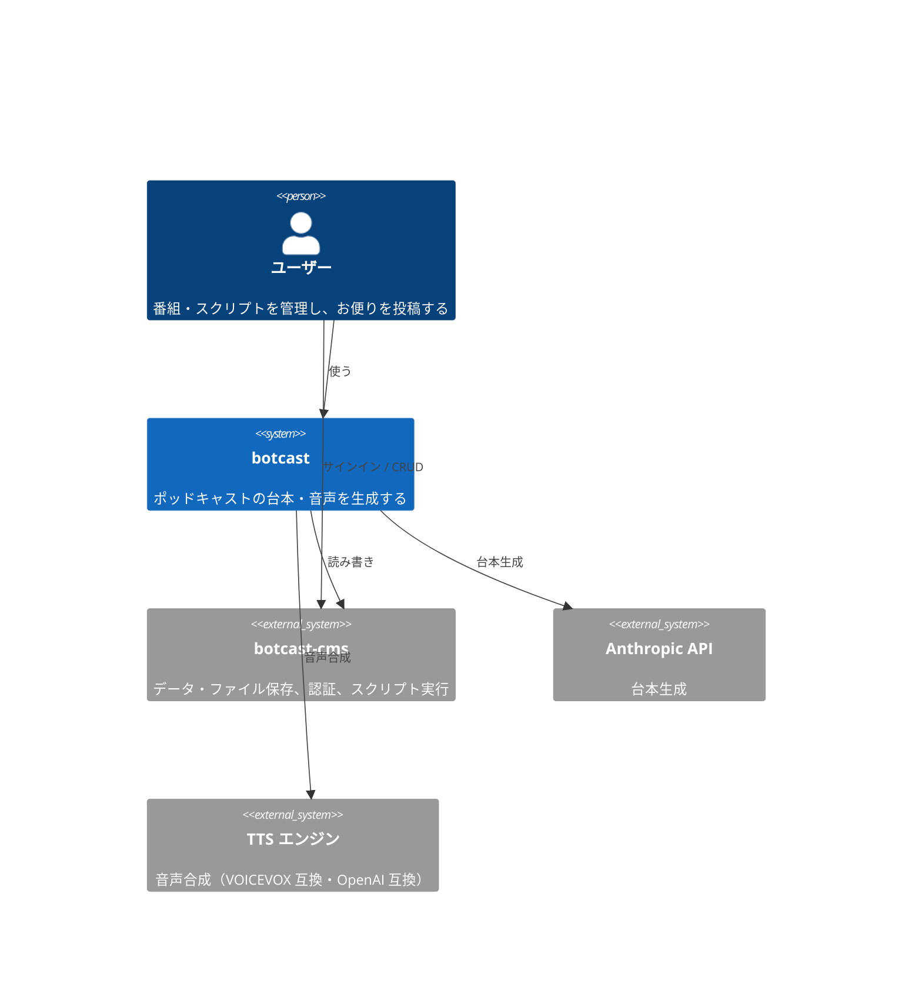
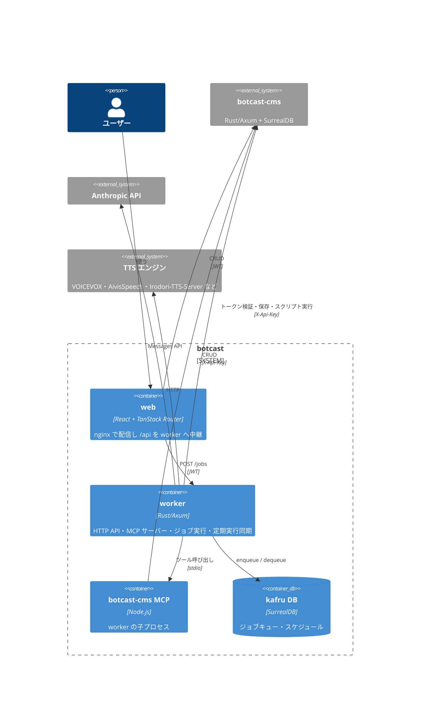
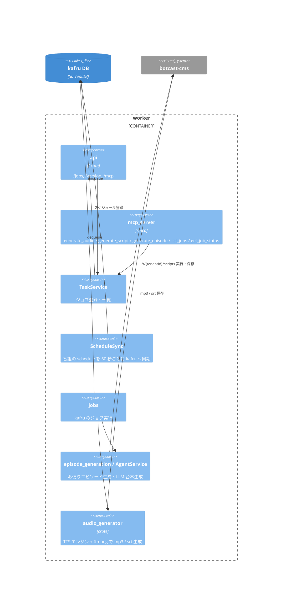

# アーキテクチャ

C4 モデルで記述する。

## Context

## Container

## Component (worker)

## 音声合成（audio_generator）

- TTS エンジンは「プロトコル」で 2 種類の窓口にまとめる: VOICEVOX 互換（`/audio_query` → `/synthesis`。VOICEVOX・AivisSpeech など）と OpenAI 互換（`POST /audio/speech`。Irodori-TTS-Server・OpenAI など）。エンジンは環境変数（`TTS_ENGINES` / `TTS_ENGINE_<NAME>_*`）で設定し、worker の起動時に検証してレジストリを作る
- エンジンは「文 1 つ → 音声のバイト列」だけを受け持つ。文の分割（100 文字まで）・各文の出力の正規化（ffmpeg で 44.1kHz・s16・2ch の wav）・長さと SRT・結合・キャッシュ・エンジンごとの同時実行数は共通の層で行う
- 入力は声が解決済みのセクション（`ResolvedVoice { engine, voice_id, params, style, seed, ref_audio }`）。今の台本の `speaker`（VOICEVOX のスタイル ID）は既定のエンジン（`TTS_DEFAULT_ENGINE`）の声として扱う。`audio_generator` は CMS を知らない
